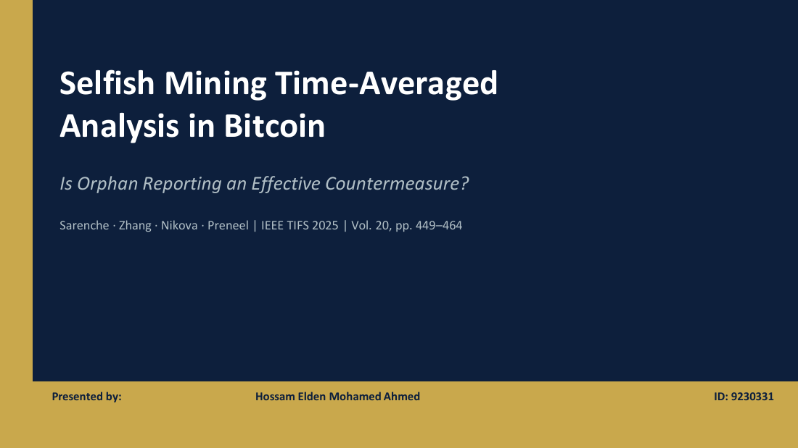
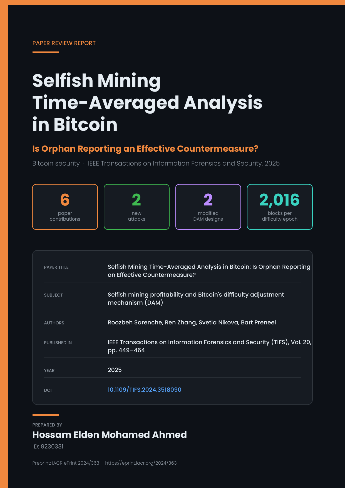

# Selfish Mining Time-Averaged Analysis in Bitcoin — Paper Review

A presentation and written review of **"Selfish Mining Time-Averaged Analysis in Bitcoin: Is Orphan Reporting an Effective Countermeasure?"** (Sarenche, Zhang, Nikova, Preneel — *IEEE Transactions on Information Forensics and Security*, 2025).

<p align="center">
  
  
</p>

## Deliverables

| | File | What it is |
|---|---|---|
| 📑 Report | [`report/Selfish-Mining-Orphan-Reporting_Paper-Review-Report.pdf`](report/Selfish-Mining-Orphan-Reporting_Paper-Review-Report.pdf) | 5-page written review: overview, problem, related work, solution, contribution, personal evaluation |
| 🎞️ Slides | [`presentation/Selfish-Mining-Orphan-Reporting_Presentation.pdf`](presentation/Selfish-Mining-Orphan-Reporting_Presentation.pdf) | 25-slide deck covering the attacks, the modified DAMs and the countermeasure analysis |
| 📄 Paper | [`paper/2024-363.pdf`](paper/2024-363.pdf) | The reviewed paper (IACR ePrint 2024/363 preprint) |

## The paper

- **Title:** Selfish Mining Time-Averaged Analysis in Bitcoin: Is Orphan Reporting an Effective Countermeasure?
- **Authors:** Roozbeh Sarenche, Ren Zhang, Svetla Nikova, Bart Preneel (COSIC, KU Leuven · Cryptape/Nervos)
- **Venue:** IEEE Transactions on Information Forensics and Security (TIFS), Vol. 20, pp. 449–464, 2025
- **DOI:** [10.1109/TIFS.2024.3518090](https://doi.org/10.1109/TIFS.2024.3518090)
- **Preprint:** [IACR ePrint 2024/363](https://eprint.iacr.org/2024/363)

The copy in [`paper/`](paper/2024-363.pdf) is the preprint, included for convenience. All rights belong to the authors and the publisher; the official version is at the DOI link above.

## Summary of the paper

Selfish mining lets a large miner withhold blocks to orphan honest work. Because Bitcoin's difficulty adjustment mechanism (DAM) ignores orphans, the attack eventually becomes profitable once the difficulty drops. It was widely believed that **counting orphan blocks in the DAM would make selfish mining completely unprofitable**. The paper tests that belief with a formal time-averaged profit analysis and contributes:

1. **Smart intermittent selfish mining v1 (SISM1)** — splits each epoch into selfish and honest parts; lower profit lag than intermittent and continuous selfish mining under today's DAM.
2. **A formal definition of uncle blocks** (the orphans a DAM may count) and **two modified DAMs** — DAM₁ (fixed total block count) and DAM₂ (fixed main-chain block count).
3. **Smart intermittent selfish mining v2 (SISM2)** — idle mining combined with selfish mining; still profitable under the modified DAMs.
4. **Orphan exclusion attack (OEA)** — stops honest blocks from being reported as orphans; analyzed with combinatorial bounds and simulation, and makes plain selfish mining profitable even under modified DAMs.
5. **A comparison of selfish mining countermeasures** (time-based, Fruitchain, DAM changes).

**Verdict:** orphan reporting does not eliminate selfish mining, but it cuts profitability substantially. DAM₁ is the more attack-resistant design.

## My evaluation (short version)

**Strengths:** formal and honest — the authors attack the very defence they evaluate; precise uncle-block definition; matching combinatorial bounds and simulations; concrete design recommendation (DAM₁).
**Limitations:** synchronous, single-adversary model with no natural orphans; results depend on parameters such as the profitability factor and epoch length; "effective" rests on numerical comparison, not a proven bound; rational miners may not report orphans; deployment means changing consensus rules.

Full argument in the [report](report/Selfish-Mining-Orphan-Reporting_Paper-Review-Report.pdf).

## Slide outline

1. Title · 2. Problem the paper solves · 3. Bitcoin & PoW background · 4. Selfish mining · 5. Difficulty adjustment mechanism · 6. Relative revenue vs. time-averaged profit · 7. Intermittent selfish mining · 8. Smart intermittent selfish mining v1 · 9. Uncle blocks & modified DAM · 10. Selfish mining under modified DAM · 11. Smart intermittent selfish mining v2 · 12–14. Orphan exclusion attack and combined profitability · 15–16. Countermeasures and Fruitchain critique · 17. Orphan reporting evaluation · 18. Why selfish mining is rare in practice · 19. Future work · 20. Contributions · 21. Profit lag comparison · 22. Model & notation · 23. DAM₁ vs DAM₂ · 24. Conclusion

## Repository structure

```
.
├── README.md
├── paper/          # the reviewed paper (.pdf)
├── presentation/   # slide deck (.pdf)
├── report/         # written review (.pdf)
└── assets/         # README preview images
```

## Author

**Hossam Elden Mohamed Ahmed** — Computer Engineering, Cairo University
[GitHub](https://github.com/hossamelden202) · [LinkedIn](https://www.linkedin.com/in/hossam-elden-mohamed)

## Citation

```bibtex
@article{sarenche2025selfish,
  title   = {Selfish Mining Time-Averaged Analysis in Bitcoin: Is Orphan Reporting an Effective Countermeasure?},
  author  = {Sarenche, Roozbeh and Zhang, Ren and Nikova, Svetla and Preneel, Bart},
  journal = {IEEE Transactions on Information Forensics and Security},
  volume  = {20},
  pages   = {449--464},
  year    = {2025},
  doi     = {10.1109/TIFS.2024.3518090}
}
```

## License

My report and slides are shared under [CC BY 4.0](https://creativecommons.org/licenses/by/4.0/). The reviewed paper belongs to its authors and publisher.
